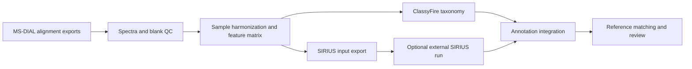

# Metabolomics Pipeline

[](https://github.com/Shunyang2018/metabolomics_pipeline/actions/workflows/ci.yml)
[](pyproject.toml)
[](LICENSE)

**An inspectable Python workflow for turning MS-DIAL alignment exports into quality-controlled, annotated feature tables.**

LC-MS studies often combine several chromatographic methods and polarities. This project handles the downstream work: filtering spectra and background, harmonizing sample names, retaining feature provenance, preparing unknowns for SIRIUS, and joining chemical taxonomy and reference matches. A modular Python API and Typer CLI expose each stage separately.

The public example runs entirely offline and produces an HTML report, CSV outputs, and a machine-readable reproduction record. It uses synthetic data; no proprietary datasets or commercial reports are required.



## Run the public example

Install [uv](https://docs.astral.sh/uv/getting-started/installation/), then:

```bash
git clone https://github.com/Shunyang2018/metabolomics_pipeline.git
cd metabolomics_pipeline
uv sync --locked --extra dev --python 3.12
uv run python examples/run_demo.py --output-dir outputs/demo
```

Open `outputs/demo/report.html` in a browser. These commands work in PowerShell, macOS and Linux shells. Once dependencies are installed, the example makes no network calls and needs no SIRIUS installation or account.

| Stage | Expected feature count |
| --- | ---: |
| Two input tables | 8 |
| MS/MS fragment filter | 7 |
| Signal-to-noise filter | 6 |
| Blank/presence QC | 5 |
| Retained after deduplication | 5 |

The five retained features have pipeline score categories 1/2/3 in counts 2/1/2. Two unknowns are exported for SIRIUS, one per polarity. Two features match the **illustrative** reference table, producing four feature/sample/reference rows. These are functional expectations, not scientific accuracy measurements. See [the example guide](examples/README.md).

Outputs include `merged.csv`, `annotated.csv`, `reference_matches.csv`, POS/NEG `.ms` files, `manifest.json` with input hashes and effective thresholds, and `report.html`. Use a new output directory for a second run.

## What the project demonstrates

- Scientific data engineering across C18/HILIC/Lipidomics exports and ionization modes.
- Testable QC and annotation rules, with stage counts and source-file provenance.
- Separate adapters for external classification and structure-annotation tools.
- Deterministic synthetic fixtures, regression tests, and multi-platform CI.
- An offline report that lets a reviewer inspect both results and reproduction details.

This repository begins **after MS-DIAL alignment**, not at instrument raw files. It does not implement a spectral-library search engine, demonstrate commercial-scale performance, or establish biological activity. [Methods and limitations](docs/methods.md) describe the scientific assumptions.

## Process your own data

An export must have four metadata rows, followed by the column header on row five. Sample intensities follow `MS/MS spectrum`. Supported inputs are comma-delimited `.csv` and tab-delimited `.txt`. Filenames must contain `POS` or `NEG` to identify polarity. See the [input contract](docs/input-format.md).

```bash
uv run metabo validate /path/to/C18_pos.csv
uv run metabo merge /path/to/alignments --output outputs/study/merged.csv
```

The default real-sample vocabulary is `crude` and `mcx`. For other sample names, pass one or more tokens explicitly:

```bash
uv run metabo merge /path/to/alignments --sample-token case --sample-token control --output outputs/study/merged.csv
```

Within an input table, normalized sample names must be unique. Across tables, matching names align into shared columns. Unrecognized sample vocabulary raises an error rather than bypassing QC. Blank names must contain a separate `blank`, `mb`, or `resuspension` token. Missing or zero blank baselines yield undefined fold changes and do not pass QC.

To run merge and reference matching without external services:

```bash
uv run metabo run --input-dir /path/to/alignments --output-dir outputs/new-study --skip-classify --skip-sirius --bioactivity-db /path/to/reference.csv
```

Use `--skip-bioactivity` when no reference database is available. `run` requires a fresh output directory unless explicitly resuming with `--skip-merge`; skipped stages are not read from old caches. A failed external stage returns a nonzero exit code.

## Optional annotation services

| Command | Purpose |
| --- | --- |
| `metabo classify INPUT --join-merged` | Append taxonomy from ClassyFire |
| `metabo classify INPUT --offline --cache-path CACHE --join-merged` | Use an explicit JSON taxonomy cache only |
| `metabo sirius --output-dir OUTPUTS --sirius-exe PATH` | Run an installed SIRIUS adapter on exported unknowns |
| `metabo sirius-collect --help` | Inspect/collect external SIRIUS result summaries |
| `metabo final --output-dir OUTPUTS` | Join existing annotation results |
| `metabo bioactivity INPUT --db REFERENCE --output OUTPUT` | Match reference records on InChIKey connectivity |
| `metabo run --help` | Orchestrate merge, external annotation, final integration and reference matching |

Run commands as `uv run metabo ...` or `uv run python -m metabo_pipeline ...`.

ClassyFire requires a reachable endpoint for uncached keys; use offline mode for reproducible review. Downloaded results default to a writable user cache, or an explicit `--cache-path`. No real taxonomy cache is bundled. SIRIUS is separately installed and licensed; account requirements, available tasks, and CLI compatibility depend on that installation. The offline suite does **not** verify live SIRIUS or ClassyFire operation. See [external integrations](docs/integrations.md).

Environment defaults: `METABO_INPUT_DIR` (default `data`), `METABO_BIOACTIVITY_DB` (default `data/bioactivity_database.csv`), and `SIRIUS_EXECUTABLE` (otherwise auto-detected). CLI paths override defaults. QC thresholds are in [`constants.py`](src/metabo_pipeline/constants.py).

## Explore the implementation

| Module | Responsibility |
| --- | --- |
| [`merge.py`](src/metabo_pipeline/merge.py) | QC stages, sample harmonization, source provenance and matrix output |
| [`qc.py`](src/metabo_pipeline/qc.py) | Fragment counts, sample groups and QC metrics |
| [`annotations.py`](src/metabo_pipeline/annotations.py) | Explicit spectral-score categories |
| [`dedup.py`](src/metabo_pipeline/dedup.py) | Unknown-feature representative selection |
| [`sirius_export.py`](src/metabo_pipeline/sirius_export.py) / [`sirius_collect.py`](src/metabo_pipeline/sirius_collect.py) | SIRIUS format boundaries |
| [`classify.py`](src/metabo_pipeline/classify.py) / [`bioactivity.py`](src/metabo_pipeline/bioactivity.py) | Taxonomy and reference joins |
| [`reporting.py`](src/metabo_pipeline/reporting.py) | Portable HTML run summaries |
| [`examples/run_demo.py`](examples/run_demo.py) | Reproducible offline example and manifest |

## Development and validation

```bash
uv sync --locked --extra dev
uv run ruff check .
uv run ruff format --check .
uv run pytest --cov=metabo_pipeline --cov-report=term-missing
```

CI runs on Linux, macOS and Windows with Python 3.10 and 3.12, and executes the public example. Tests cover parsing, filtering, annotation, deduplication, export/result parsing, CLI behavior, stale-output regressions and the offline demonstration. Passing synthetic tests validates software behavior; it is not evidence of identification accuracy on experimental datasets.

Contributions are welcome; see [CONTRIBUTING.md](CONTRIBUTING.md), [the review record](docs/review.md), and [CHANGELOG.md](CHANGELOG.md). Cite the software using [CITATION.cff](CITATION.cff). Original contributors remain recorded in Git history.

## License and data

Source code is under the [MIT license](LICENSE). The bundled example fixtures are synthetic, created for this repository and released under the same license. External software, database records and service responses retain their own terms; they are not relicensed by this project. See [data and dependency provenance](docs/data-and-dependencies.md).
